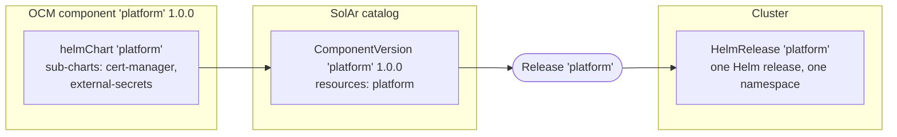
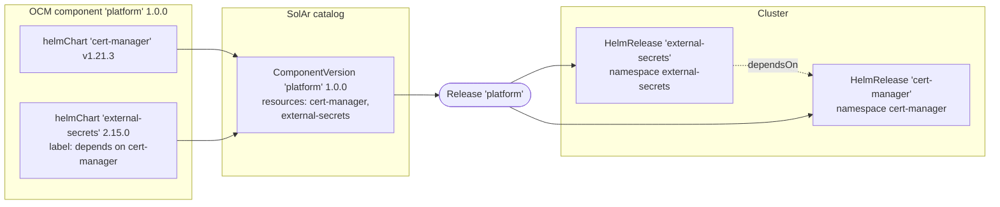
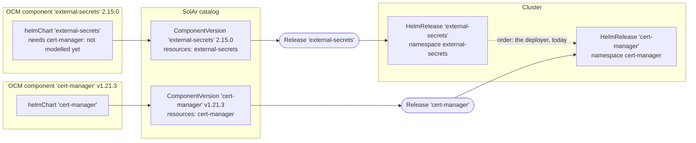

# Products with Several Helm Charts

## Context and Problem Statement

SolAr accepts a component only if it carries exactly one `helmChart` resource
and renders one `HelmRelease` for it. Products that consist of several charts,
typically an operator and what it manages, have to be packed into one chart
first ([#925](https://github.com/opendefensecloud/solution-arsenal/issues/925)).

Charts also differ in where they have to run. Some need a certain namespace:
[Tetragon](https://tetragon.io/docs/installation/kubernetes/) is documented for
`kube-system` and runs a privileged agent with host access, so it needs a
namespace that admits such pods. Istio's `istiod` chart assumes `istio-system`:
installed elsewhere with its defaults, it still puts its service account there.
Today the Release sets one namespace for the whole component, and the component
cannot state what a chart needs.

How should a product with several Helm charts be packaged, so that SolAr can
install, upgrade and remove the charts in the right order, each in the
namespace it needs, and so that the catalog shows what was delivered?

This ADR decides the model only. It was prepared by the spike
[#941](https://github.com/opendefensecloud/solution-arsenal/issues/941). All
three options were run on a dev cluster; fixtures and results are in
[`test/fixtures/multi-helm`](../../../test/fixtures/multi-helm/README.md).

## Considered Options

The diagrams use two real charts as the example:

- [cert-manager](https://cert-manager.io/) v1.21.3
- [External Secrets Operator](https://external-secrets.io/), chart
  `external-secrets` 2.15.0. With `webhook.certManager.enabled` it creates a
  cert-manager `Certificate` for its webhook, so it can only be installed
  after cert-manager.

In A and B somebody packs both into one component, here called `platform`
1.0.0. Each diagram shows what is packaged, what the catalog lists, and what
runs. The rounded node is the SolAr `Release` that deploys a
ComponentVersion. The findings below were measured with two small fixture charts that
depend on each other in the same way, not with these two.

**A, umbrella chart.** The author combines the charts as Helm sub-charts. The
component keeps one `helmChart` resource.

**B, one resource per chart.** The component carries one `helmChart` resource
per chart. A label on a chart names the charts it depends on. SolAr renders one
`HelmRelease` per chart and orders them with Flux `dependsOn`.

**C, one component per chart.** Each chart is a component with a version of
its own, deployed by a Release of its own. One constructor file can define
several components, and a component can reference others by digest, so this
needs no separate build per chart.

## Decision Outcome

Chosen: **C by default, B for the charts of one product.** A component is what
one owner versions, signs and delivers together.

- **C** for software with an identity of its own: third-party charts, platform
  software, anything several products use. Examples: cert-manager, External
  Secrets Operator, Tetragon, Istio. The catalog lists it once, under its own
  version. The example above is therefore a case for C.
- **B** for charts that are released together and never deployed apart: a
  product's CRD chart and main chart, its own operator and what that manages,
  its optional parts.
- **A** stays valid, as a component with one chart. It suits charts that do
  not depend on each other's CRDs or controllers and share a namespace.

| Use case from #941 | Model |
|---|---|
| Charts owned by third parties | C |
| Dependent charts of one product | B |
| Bundle of one product's services | B, or A if they are independent |
| Optional charts | B |

B and C need the same from SolAr: several `HelmRelease` objects on a Target,
installed in order and removed in reverse. They differ in where the order
comes from, a label in the component (B) or a dependency between components
(C). The latter is the subject of the
[component contracts RFC](https://github.com/opendefensecloud/ocm-kit/pull/60);
[ADR 011](011-component-dependencies.md) rejected resolving it in SolAr. Until
then the deployer orders the Releases of C.

### Findings

| | A, umbrella | B, one resource per chart | C, one component per chart |
|---|---|---|---|
| Install with the CRD as a template of the operator chart | fails, Helm validates all sub-charts against the cluster first | works, in order | works, if the operator's Release comes first |
| Install with the CRD moved to the umbrella's `crds/` | works | not needed | not needed |
| Upgrade | one Helm operation, not ordered by chart | a failing chart holds back its dependents. Not ordered by version, see below | per Release |
| Removal of everything at once | resource stuck: the operator is gone before it releases the finalizer | the same: `dependsOn` does not order removal | not run, the mechanism is B's |
| Removal in reverse order | not possible, one Helm release | clean | clean |
| Namespace | one for all sub-charts: a chart that needs a certain namespace takes the others with it | per chart | per Release |
| Values | one document, keyed by sub-chart | per chart | per Release |
| What the catalog shows | the umbrella chart only | the product, with its charts as resources | every chart as an entry with its own version |
| Transport as an archive | one component | one component | every component, or a component that references them, transferred with `--recursive` |
| Works with SolAr today | yes | no | yes, without ordering |

Where a chart ships a shared CRD as a template, as cert-manager does, A
requires the author to move it out of that chart, which is not possible
without a switch for its CRDs. CRDs in a sub-chart's `crds/` directory are
installed first by Helm and need no change. No option removes an
operator and its resources cleanly as it stands. In B and C the order is
known outside Helm and can be applied in reverse. In A it is inside one Helm
release.

`dependsOn` also orders two Releases: set between the `HelmRelease` objects
the bootstrap chart creates per Release, the second waited until everything
in the first was ready.

This holds for install. On upgrade `dependsOn` only checks that a dependency
is ready, not at which version. A dependent can therefore be upgraded while
its dependency is still ready at the old version.

### Namespaces

Each chart is deployed to its own namespace:

- The component may name a namespace on a chart resource. It is the default
  for that chart, also in a component with one chart.
- The Release sets the namespace of the charts that name none, as
  `targetNamespace` does today, and may override the ones that do.

With an umbrella chart this is not possible. A Helm release has one namespace,
and a sub-chart leaves it only if it offers a value for that. Tetragon's chart
(1.8.0) offers none and deploys everything to the release namespace, so the
charts packed with it would run in `kube-system` too.

In every model a chart can also write outside its namespace. Rendered with
defaults into another namespace, `istiod` (1.30.8) creates a service account
and a role in `istio-system`, and cert-manager (v1.21.3) creates its leader
election roles in `kube-system`. The namespace of a chart is therefore where
its release lives, not a limit on what it touches.

### Consequences

➕ is a gain over today, ➖ a cost or an open point.

| | B, charts of one product | C, one component per chart |
|---|---|---|
| Catalog | ➖ a chart is listed only as a resource of its product. The same chart in two components is two unrelated resources | ➕ every chart is listed as what it is, under its own version |
| Values and namespace | ➕ per chart | ➕ per Release, the chart is used as published |
| Install and upgrade order | ➕ install order from Flux `dependsOn`, with nothing new to run ➖ an upgrade is not ordered by version | ➕ the same mechanism ➖ SolAr does not render it between Releases yet. Until then the deployer orders them |
| Install time | ➖ Flux rechecks a dependency every 30 seconds, so each level of dependency adds up to that | ➖ the same |
| Removal | ➖ not ordered by `dependsOn`. SolAr has to remove dependents first. How is open | ➖ the same |
| Work in SolAr | ➖ discovery, the ComponentVersion and the release chart have to change. Until then B does not work at all | ➕ works today, without ordering |
| Shipping and signing | ➕ the product is one component | ➖ a product is not one unit. A transfer that misses a component is noticed only at install time |
| Shared software | ➖ nothing keeps an author from packing it into a product. Two products that bring the same operator collide on its CRDs. The rule above is a packaging guideline only | ➕ listed and installed once |
| Namespaces on the Target | ➖ a component can send a chart to a namespace such as `kube-system` without the Release naming it. Nothing on the Target limits the namespaces a Release may use, as is already the case for `targetNamespace` | ➖ the same |

A keeps working as it does today and gains only the namespace default.

A component that only references the others closes the shipping gap of C:
its signature pins them by digest, as the catalog index of
[ADR 017](017-catalog-chaining-catalog-index.md) does. SolAr rejects such a
component today, as it has no chart.

## More Information

Not decided here, to be handled in follow-up issues under #925:

- **Dependency label.** B needs a label on a `helmChart` resource that names
  the chart resources to install before it. Its name and format are open. The
  fixtures use `opendefense.cloud/helm/depends-on`, as #941 suggests.
  [#435](https://github.com/opendefensecloud/solution-arsenal/issues/435)
  proposes a label such as `opendefense.cloud/helm/entrypoint` to pick one
  chart out of several. With an ordered set of charts there is no single
  entrypoint, so that label is either dropped or redefined.
- **Charts of a ComponentVersion.** `spec.entrypoint` names one resource. For
  B it has to become a list: each chart with what it depends on and its
  default namespace. Discovery writes the list, the renderer only reads it.
  ComponentVersions that exist today carry `entrypoint` only and have to keep
  working. Catalog and UI then show a component's charts with name, version
  and app version, which the ComponentVersion already holds per resource.
- **Values per chart.** `Release.spec.values` is one document for one chart.
  For B the Release needs values per chart, addressed by resource name, while
  `values` keeps its meaning for a component with one chart. Values templates
  are already attached per chart in the component, but the renderer reads
  only the entrypoint's. It has to render one per chart, or the images of
  the other charts are not re-mapped to the target registry.
- **Optional charts.** The decision assigns them to B, but the spike did not
  run this case. Open is how a Release leaves a chart out, and what happens
  to the charts that depend on it.
- **Order between Releases.** For C the bootstrap chart creates one
  `HelmRelease` per Release, with no `dependsOn`. Open is where the
  dependency is stated until component contracts exist, for example on the
  Release, and how SolAr reports a dependency that is not on the Target.
- **Ordered removal.** SolAr has to remove dependents first and wait for
  them, inside a component (B) and between Releases (C). Nothing does that
  today, and removing everything at once leaves resources stuck.
- **Upgrade order.** `dependsOn` does not make a dependent wait for the new
  version of its dependency. Flux offers `readyExpr` on a dependency for
  that. Open is whether SolAr renders it, and from which information.
- **Namespace per chart.** How the component names a chart's namespace,
  likely a label as above, and whether it is a default or a requirement.
  `Release.spec.targetNamespace` is one value. For B it needs an override per
  chart.
- **Namespaces on a Target.** A Release may use any namespace today, and it
  is created without labels. Open is who decides which namespaces a Target
  admits, how that holds for a chart that writes to several, and who creates
  and labels a namespace, for example with the pod security level Tetragon
  needs.
- **Product component.** A component with component references and no chart,
  to release, ship and sign several components as one product. Discovery
  rejects it today. Open is how the catalog lists it, whether releasing it
  creates a Release per referenced component, and how it relates to the
  catalog index of ADR 017.
- **Plain manifests.** A component whose resources are manifests instead of
  charts, such as an operator that ships only CRDs and a Deployment. Not
  covered by the spike.
- **Documentation.** The user guide needs the packaging rule, when to use C
  and when B, the labels, and values templating for several charts.

The dependency label, the charts of a ComponentVersion and plain manifests
are parts of one question: which shapes of component SolAr accepts, and how
it turns each into a list of charts to deploy. That should be an ADR of its
own.
