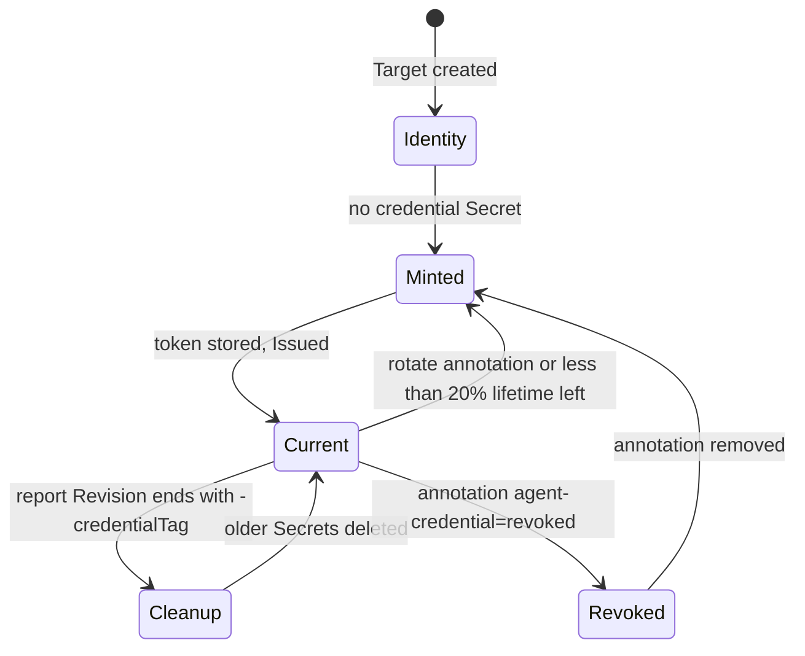

# AgentCredential Controller

## Overview

The AgentCredential controller gives each `Target` an identity in the SolAr
cluster for its `solar-agent`. It is active only when `--agent-apiserver-url` is
set. The code is in `pkg/controller/agentcredential_controller.go` and
`pkg/controller/agentcredential.go`.

For how the credential reaches the agent, see [Target
Controller](./target_controller.md#agent-credential-injection) and the
[RenderTask controller](./rendertask_controller.md). For the operator and user
side, see [Setting up the solar-agent](../operator-manual/solar-agent.md).

## Objects

All objects live in the Target's namespace. They are owned by the Target
(`ownerReferences`) and also removed by the finalizer.

| Object | Name | Content |
| ------ | ---- | ------- |
| ServiceAccount | `solar-agent-<target>` | |
| Role | `solar-agent-<target>` | `get` on `targets` and `get`, `update` on `targetreports`, both limited by `resourceNames` to `<target>` |
| RoleBinding | `solar-agent-<target>` | Role to ServiceAccount |
| TargetReport | `<target>` | Empty spec, created only if missing |
| Secret | `solar-agent-<target>-<n>` | Key `token`; label `solar.opendefense.cloud/agent-credential: <target>`; annotations `rotation-request` and `expires-at` |

RBAC cannot restrict `create` to one name, so the controller pre-creates the
`TargetReport`. The agent has no `create` permission. An empty report rolls up
to `PreflightReady=Unknown`, so the pre-created report does not mark the Target
healthy.

`<n>` is one more than the highest suffix among the Target's credential Secrets,
starting at 1. The newest Secret that holds a token is the current credential.

Credential Secrets are read through an uncached reader. A stale cache could
otherwise hide a Secret that was just created and cause a second mint.

## Finalizer

`solar.opendefense.cloud/agent-credential-finalizer` is set on the Target. On
deletion the controller deletes the credential Secrets, RoleBinding, Role,
ServiceAccount and TargetReport, then removes the finalizer. When the feature is
off, no finalizer is added.

## Lifecycle

1. **Mint.** The controller ensures ServiceAccount, Role, RoleBinding and
   TargetReport. If there is no credential, or the newest has no token, or a
   rotation is due, it creates Secret `<n>` and requests a token for the
   ServiceAccount. The token is bound to that Secret and has an explicit
   `expirationSeconds` from `--agent-token-ttl`. Without it TokenRequest would
   default to one hour. The token and `expires-at` are written to the Secret. If
   the TokenRequest or the update fails, the Secret is deleted again, so an empty
   newest Secret is never rendered.
2. **Rotate.** A new value in `solar.opendefense.cloud/rotate-agent-credential`
   that no Secret has answered (annotation `rotation-request`) triggers a mint.
   Less than 20% of lifetime remaining triggers one too. The controller requeues
   at that point.
3. **Cleanup.** Older Secrets are deleted only after the `TargetReport` shows a
   release whose `Revision` ends in `-<credentialTag>` of the current Secret.
   Both tokens authenticate as the same ServiceAccount, so reports alone cannot
   prove the switch. Until then the old token keeps working.
4. **Revoke.** With `solar.opendefense.cloud/agent-credential: revoked` the
   controller deletes all credential Secrets and mints none. It keeps the
   ServiceAccount, Role and RoleBinding. The bound token dies with its Secret.
   Revocation is checked right after deletion handling, before the `Disabled`
   check and before any identity is ensured, so it holds even when credentials
   are disabled. Removing the annotation mints a fresh credential.

## Conditions

`AgentCredentialReady` on the Target:

| Status | Reason | When |
| ------ | ------ | ---- |
| `True` | `Issued` | A current credential exists |
| `False` | `Disabled` | `--agent-apiserver-url` is empty |
| `False` | `Revoked` | The revoke annotation is set |
| `False` | `MintFailed` | Creating the identity or the token failed |

## Why the tag hashes the Secret UID

`credentialTag` is a short hash of the Secret's UID, and the Target controller
appends it to the release chart tag. It does not use the Secret name for two
reasons:

- The release chart repository is per namespace, so two Targets in one namespace
  share it. Their credentials must give different tags.
- A Secret name is reused after a revoke. A repeated tag would make the renderer
  skip the push and ship the old, revoked token.

A new tag also changes the bootstrap input, so the bootstrap re-renders and Flux
picks up the new chart.

## Watches

| Watched Resource | Mapping |
| ---------------- | ------- |
| `Target` | Direct reconcile |
| `Secret` | The Target named by the `solar.opendefense.cloud/agent-credential` label |
| `TargetReport` | The Target with the same name |

## RBAC

The controller needs the rights it hands out, because Kubernetes prevents
privilege escalation when creating a Role. It also needs `create` on
`serviceaccounts/token` and write access to Secrets. The markers are in
`agentcredential_controller.go`; `make manifests` regenerates the ClusterRole.
