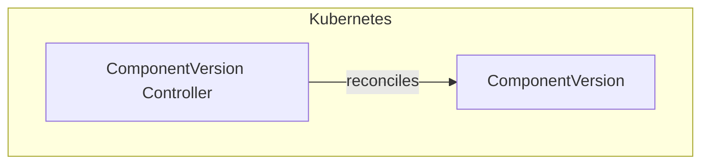
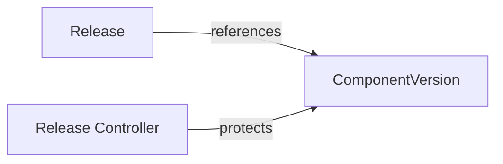

# ComponentVersion Controller Documentation

## Overview

The ComponentVersion controller manages the self-finalizer on each `ComponentVersion` and maintains its `Available` condition by re-checking the backing descriptor manifest in its registry.

## Architecture

## Finalizers

| Finalizer | On resource | Purpose |
|---|---|---|
| `solar.opendefense.cloud/componentversion-finalizer` | ComponentVersion | Allows controllers to observe deletion before the object is garbage-collected |

On deletion, the controller removes `solar.opendefense.cloud/componentversion-finalizer` from the ComponentVersion, allowing it to be garbage-collected.

## Availability

On every reconcile the controller resolves `<spec.registry>/<namespace>/component-descriptors/<componentName>@<spec.digest>` with the credentials of the `Registry` in the same namespace whose hostname matches `spec.registry`, and updates `Available`:

| Result | Current `Available` | New `Available` |
|---|---|---|
| 200 | any | `True/ArtifactAvailable` |
| 404 | not pending, not `False` | `Unknown/ArtifactMissingPending` (grace timer starts) |
| 404 | pending for less than the grace period | unchanged |
| 404 | pending for at least the grace period | `False/ArtifactMissing` |
| 404 | `False` | unchanged |
| other error | any | `Unknown/RegistryUnreachable` |
| no `spec.digest` | any | `Unknown/NoDigest` |
| no matching `Registry` | any | `Unknown/RegistryNotConfigured` |

Registry checks share one token bucket per controller process (`--componentversion-availability-qps`, default `10`, and `--componentversion-availability-burst`, default `20`). A check that finds no free token is not run; the ComponentVersion is requeued for when a token is free, so a throttled check never holds a worker. ComponentVersions without a digest or without a matching Registry use no tokens. Size the rate so that the number of ComponentVersions ≤ interval × qps (3,000 with the defaults); above that, checks still happen, but each ComponentVersion is checked less often than the interval and turns red later. `--componentversion-max-concurrent-reconciles` (default `4`) sets how many ComponentVersions are reconciled in parallel, which is how many slow registries can be waited on at once.

A read error never produces `False`, and the controller never deletes a ComponentVersion. `--componentversion-availability-interval` (default `5m`) sets how often each ComponentVersion is re-checked; `--componentversion-availability-grace` (default `15m`) sets how long a manifest must stay missing before it turns red.

## Watch Triggers

The ComponentVersion controller is triggered when:

- A `ComponentVersion` resource is created, updated, or deleted. Updates that change only status are ignored.
- Every reconcile requeues after `--componentversion-availability-interval`.
- Discovery changes the `solar.opendefense.cloud/availability-recheck` annotation on a registry delete event, which triggers an immediate check.

## Relationship to Other Controllers

ComponentVersions are themselves protected from deletion by the Release controller: a ComponentVersion cannot be deleted while a Release references it. Once the last Release is removed, the ComponentVersion can be deleted.
