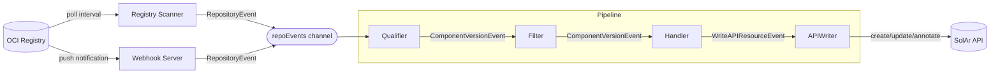
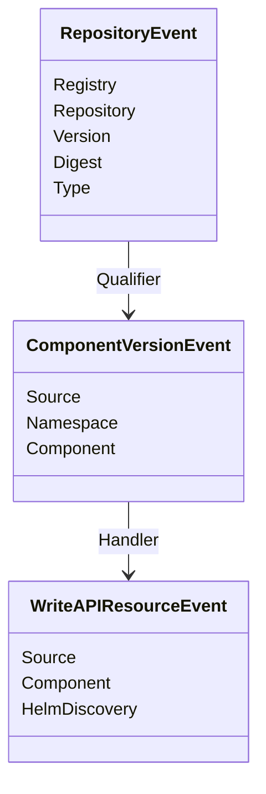
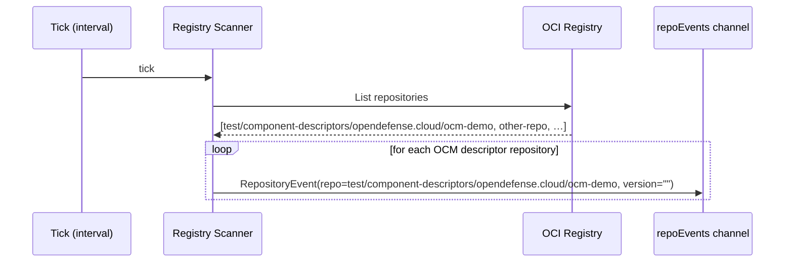
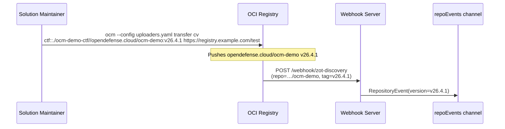
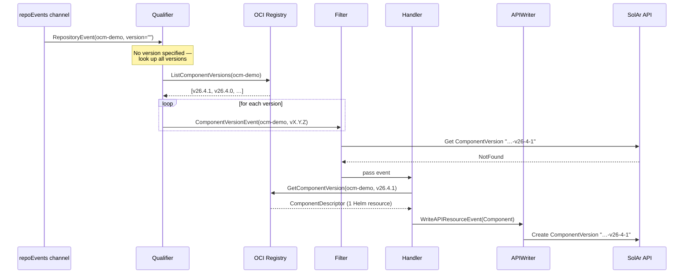
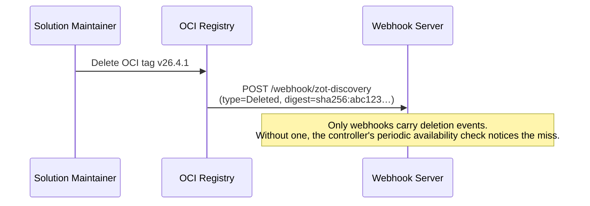

# Discovery Pipeline Documentation

## Overview

The SolAr discovery pipeline (`solar-discovery`) is a standalone component that discovers OCM (Open Component Model) packages in OCI registries and writes them into the SolAr API as `ComponentVersion` resources.

Discovery is triggered in two ways: by periodically scanning a registry for all repositories, or by receiving push notifications from the registry via webhook. These modes can be used together or independently (`scanInterval: 0` disables polling).

The pipeline is composed of a chain of channel-connected stages. Each stage processes events from its input channel and publishes results to its output channel, making the pipeline fully asynchronous and back-pressure-aware.

## Pipeline Stages



### Event Sources

| Source          | Output            | Responsibility                                                          |
| --------------- | ----------------- | ----------------------------------------------------------------------- |
| RegistryScanner | `RepositoryEvent` | Periodically scans all repositories in an OCI registry                  |
| WebhookServer   | `RepositoryEvent` | Accepts push notifications from OCI registries and emits events directly |

### Pipeline Stages

| Stage     | Input                   | Output                  | Responsibility                                                                   |
| --------- | ----------------------- | ----------------------- | -------------------------------------------------------------------------------- |
| Qualifier | `RepositoryEvent`       | `ComponentVersionEvent` | Resolves repository name to namespace + component, looks up all versions via OCM |
| Filter    | `ComponentVersionEvent` | `ComponentVersionEvent` | Drops events for ComponentVersions that already exist in the cluster             |
| Handler   | `ComponentVersionEvent` | `WriteAPIResourceEvent` | Fetches the OCM component descriptor and builds the API resource payload         |
| APIWriter | `WriteAPIResourceEvent` | –                       | Creates or updates `ComponentVersion` resources; on delete events annotates them for an availability re-check |

## Event Types



`Source` retains the originating event: version, digest, and event type are
available through `ComponentVersionEvent.Source` and
`WriteAPIResourceEvent.Source.Source`. `WriteAPIResourceEvent.Component`
is a `descruntime.Component`.

## Registry Scanner

The `RegistryScanner` scans a single OCI registry immediately on startup and then at the positive interval configured in `Registry.spec.scanInterval`. With an unset or zero interval, the pipeline does not start a scanner. It lists repositories via ORAS and emits a `RepositoryEvent` only for paths matching the OCM component-descriptor layout. Concurrent scans are prevented by a mutex — if a scan is still running when the next tick fires, the tick is skipped.

OCI registries can also push change notifications via webhooks. The `WebhookServer` accepts HTTP POST requests on configured paths and converts them directly into `RepositoryEvent`s, bypassing the polling interval.

## Qualifier

The Qualifier resolves a raw `RepositoryEvent` (registry + repository path) into one or more `ComponentVersionEvent`s by:

1. Splitting `<base>/component-descriptors/<component>` into the repository namespace (`<base>`) and component name. The base may be empty; unrelated repository paths are rejected.
2. If the event already carries a specific version (e.g. from a webhook), emitting a single event for that version.
3. Otherwise, looking up all versions of the component in the OCM repository and emitting one event per version.

Deletion events pass through without an OCM lookup.

## Filter

The Filter prevents duplicate work. For `EventCreated` events it checks whether the corresponding `ComponentVersion` already exists in the SolAr API. If it does, the event is silently dropped. All other event types (update, delete) pass through unconditionally.

## Handler

The Handler fetches the OCM component descriptor for a component version and builds the `ComponentVersion` payload. Only components that satisfy the [OCM packaging contract](../user-guide/ocm-packaging.md) are processed.

The descriptor is fetched through `ocmv2.Repository.GetComponentVersion`. The handler passes its `descruntime.Component` and discovered Helm metadata to the APIWriter.

## APIWriter

The APIWriter creates or updates `ComponentVersion` resources in the SolAr API. Each ComponentVersion carries the OCM component name and its source `scheme`, `registry` and `repository`. Each ComponentVersion also records the descriptor's full manifest digest in `spec.digest` and starts with `Available=True`; from then on the ComponentVersion controller owns availability.

An OCM component version is immutable, so an update whose descriptor digest differs from the recorded one is refused and only logged: the tag was re-pushed with other content. The ComponentVersion keeps pointing at the descriptor it was discovered from, which the controller then reports as missing. Delete the ComponentVersion to re-discover the new content. The scan path reaches the same outcome because the Filter never updates an existing ComponentVersion.

## Sequence Diagrams

### Scanner: Periodic poll discovers changes



### Webhook: Registry pushes a change notification



### Shared pipeline: qualify, filter & write

Once a `RepositoryEvent` is on the channel, both the scanner and webhook paths converge into this shared pipeline starting with the Qualifier.



### Component version deleted from registry



#### Pipeline passthrough & availability re-check

```mermaid
sequenceDiagram
    participant Qualifier as Qualifier
    participant Filter as Filter
    participant Handler as Handler
    participant Writer as APIWriter
    participant K8s as SolAr API

    Note over Qualifier: RepositoryEvent(type=Deleted) —<br/>no OCM lookup needed
    Qualifier->>Filter: ComponentVersionEvent(type=Deleted)
    Note over Filter: Deletions bypass exists-check
    Filter->>Handler: pass through
    Note over Handler: No descriptor fetch needed
    Handler->>Writer: WriteAPIResourceEvent(type=Deleted, digest=sha256:abc123…)
    Writer->>K8s: List CVs (fieldSelector: spec.digest=sha256:abc123…)
    K8s-->>Writer: [ocm-demo-v26-4-1]
    Writer->>K8s: Patch annotation availability-recheck=<timestamp>
    Note over K8s: ComponentVersion controller re-checks the manifest;<br/>Available goes Unknown, then False after the grace period
```

## Configuration

The `solar-discovery` binary uses `--namespace` to select the namespace in
which it watches `Registry` resources and credential Secrets, and `--listen`
to set the webhook listen address. Per-registry settings live in
`Registry.spec`:

| Setting | Description |
| ------- | ----------- |
| `hostname` | Registry host, optionally including a port |
| `scanInterval` | Positive polling interval, such as `30s`; unset or `0s` disables scanning |
| `webhookPath` | HTTP path for push notifications; unset disables webhooks |
| `flavor` | Registry type used for webhook routing, required with `webhookPath` |
| `solarSecretRef` | Reference to a credential Secret in the same namespace; omit for anonymous discovery |
| `plainHTTP` | Use HTTP instead of HTTPS; defaults to false |

The transfer example uses the OCM v2 uploader configuration described in the
[packaging guide](../user-guide/ocm-packaging.md#1-published-to-an-oci-registry).
