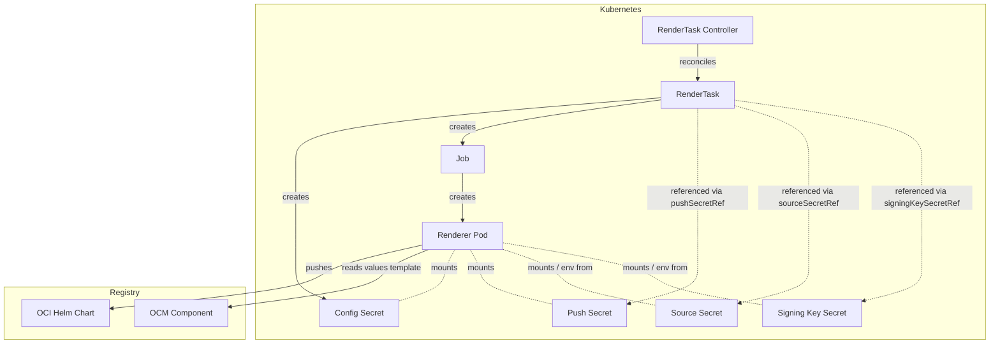
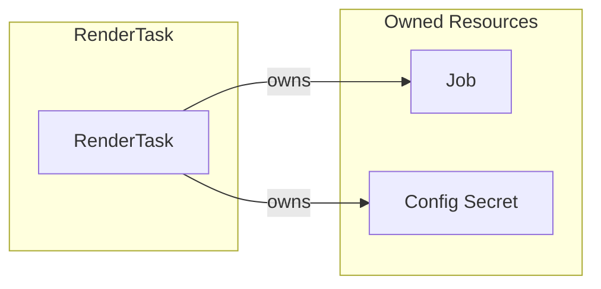
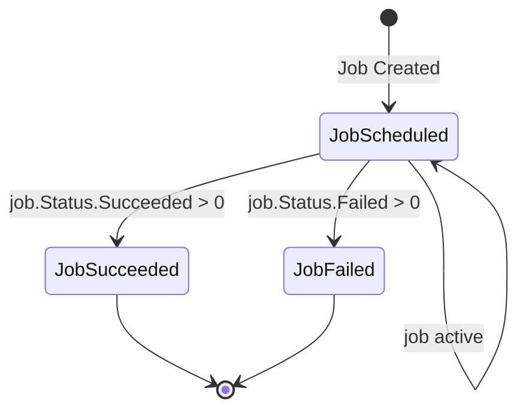

# RenderTask Controller Documentation

## Overview

The RenderTask controller manages the lifecycle of `RenderTask` custom
resources in SolAr. It creates and manages a Kubernetes Job that executes the
renderer container, along with a configuration Secret.

A RenderTask is immutable once created.

## Architecture

## Resource Owner References

## Status Conditions

The controller updates the RenderTask status with the following conditions:

| Condition      | Status  | Reason                     |
| -------------- | ------- | -------------------------- |
| `JobScheduled` | `True`  | Job is running (active)    |
| `JobScheduled` | `False` | Job does not exist         |
| `JobSucceeded` | `True`  | Job completed successfully |
| `JobFailed`    | `True`  | Job failed                 |

## Resource Naming Convention

| Resource     | Name Pattern               | Namespace |
| ------------ | -------------------------- | --------- |
| RenderJob    | `render-<rendertask-name>` | Inherited |
| ConfigSecret | `render-<rendertask-name>` | Inherited |

## Cleanup Behavior

- **On successful completion**: Deletes Job and config Secret.
- **On deletion**: Owned resources (Job and config Secret) are garbage-collected by Kubernetes via owner references.
- **On failure**: Config Secret is deleted after `spec.failedJobTTL` (default 1 hour). The Job is removed by Kubernetes via `TTLSecondsAfterFinished`.

## Controller Configuration

Configuration of the controller is managed by the controller manager. The
RenderTask controller can be configured with the following parameters:

| Parameter                  | Type       | Description                                                                                    |
| -------------------------- | ---------- | ---------------------------------------------------------------------------------------------- |
| `RendererImage`            | `string`   | Image to be used for the render Job / Pod                                                      |
| `RendererCommand`          | `string`   | Command for the render Job / Pod                                                               |
| `RendererArgs`             | `[]string` | Additional args for the render Job / Pod                                                       |
| `RendererCAConfigMap`      | `string`   | ConfigMap name carrying a CA bundle mounted into the render Pod for registry connections       |
| `RendererImagePullSecrets` | `[]string` | Image pull Secret names attached to the render Pod (must exist in each RenderTask's namespace) |

## Per-Task Registry Credentials

A render Job talks to two registries, and each gets its own credentials on
the RenderTask spec.

### Push credentials (`pushSecretRef`)

Each RenderTask carries its own `baseURL` and `pushSecretRef`, which are
resolved by the Target controller from the Target's `renderRegistryRef`:

1. The Target references a **Registry** resource via `spec.renderRegistryRef`.
2. The Registry provides the OCI hostname (`spec.hostname`) and a secret
   reference (`spec.solarSecretRef`) containing push credentials.
3. When creating a RenderTask, the Target controller sets these values on the
   RenderTask spec so the renderer Job can authenticate to the registry.

If `pushSecretRef` is set on the RenderTask, the controller mounts the
referenced secret directly into the renderer Pod. The push secret is managed
externally and is not owned by the RenderTask.

A `kubernetes.io/dockerconfigjson` push secret is mounted as
`/etc/renderer/docker/config.json`, and `DOCKER_CONFIG` is set to the directory
`/etc/renderer/docker`. It has to be the directory, because the keychain that
signing authenticates with looks for `config.json` inside it.

### Target credential (`targetCredentialSecretRef`)

When `spec.targetCredentialSecretRef` is set, the Job's container gets the env var `TARGET_CREDENTIAL_TOKEN`, sourced from that Secret's `token` key via a `secretKeyRef`. The token value never passes through the RenderTask or its config Secret.

Before it creates the Job, the controller checks that the Secret is a credential of the Target that owns the task: `spec.ownerKind` must be `Target` in the task's namespace, and the Secret must carry the labels `solar.opendefense.cloud/agent-credential: <ownerName>` and `solar.opendefense.cloud/agent-credential-target-uid: <Target UID>`. Otherwise no Job is created, an `InvalidTargetCredential` event is recorded and the reconcile is retried. Creating such a RenderTask also needs the verb `inject-target-credential` on `rendertasks` (admission plugin `SolarTargetCredential`); the controller-manager's ClusterRole holds it.

### Signing key (`signingKeySecretRef`)

The Target controller copies `spec.signing.keySecretRef` from the Target onto its release and bootstrap RenderTasks, once the key passed validation (see the `SigningKeyResolved` condition of the [Target controller](./target_controller.md)).

- The Secret's `cosign.key` is mounted read-only at `/etc/renderer/signing/cosign.key`. Only this path goes into the config Secret, as `signing.keyPath`. The RenderTask spec holds just the Secret name.
- `COSIGN_PASSWORD` comes from the Secret's `cosign.password` via an optional `secretKeyRef`, because a key may have an empty password.
- A release RenderTask carries the first 8 hex chars of the sha256 over key and password in its tag, so it reads `v0.0.<generation>-<pullhash>-<keyTag>`, followed by the agent credential suffix if there is one. The chart repository is shared by all Targets in a namespace, and a re-push under a shared tag would break the earlier signature.
- The same key tag goes into the hash in the task name (`render-rel-<release-name>-<hash>`), so a task recreated for a new key cannot reuse the old task's Job and config Secret.
- A bootstrap RenderTask keeps its name and tag pattern, because its repository belongs to one Target. A new key still leads to a new bootstrap version, since the release tags in its input change.
- Like `targetCredentialSecretRef`, creating or changing a RenderTask with `signingKeySecretRef` needs the verb `inject-target-credential` on `rendertasks`, so only solar-controller-manager can point a render Job at a key.

### Source credentials (`sourceSecretRef`)

The renderer also reads the OCM component itself, to fetch and render the
component's [helm values template](../user-guide/helm-values-templating.md).
That source registry is frequently not the push registry.

The Target controller resolves it by matching the ComponentVersion's
`spec.registry` hostname against the Registry resources in the ComponentVersion's
namespace, and copies that Registry's `spec.solarSecretRef` onto the
RenderTask as `sourceSecretRef`. A source registry with no matching
Registry resource is read anonymously.

Both shapes a `solarSecretRef` can take are handled, mirroring the push path:
A basic-auth Secret and a `kubernetes.io/dockerconfigjson` Secret.
Basic-auth selection is by key rather than Secret type, because the discovery
worker consumes `solarSecretRef` the same way and existing credentials are a mix
of `kubernetes.io/basic-auth` and `Opaque`. Keys present but empty are treated as
absent. The docker config is mounted at its own path so it cannot collide with
the push secret's, which commonly belongs to a different registry.

A Secret matching neither shape leaves the renderer on anonymous access. There is
no implicit fallback: SolAr never applies OCM's default config handlers, so
`~/.docker/config.json` is not consulted unless passed explicitly.

Only secret _names_ are stored on the RenderTask. Credential material never
goes into `RendererConfig`, because that struct is inlined into
`RenderTaskSpec` and would end up readable by anyone with RenderTask read
access.
