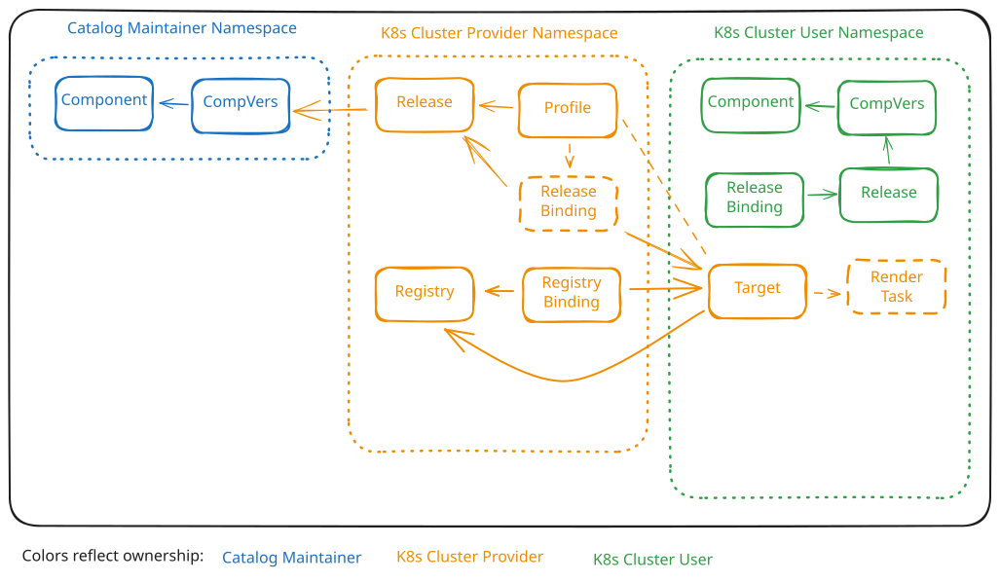

# Roles

The roles serve as a blueprint for the intended usage scenario of Solar. These definitions are not rigid constraints; users can adapt, combine, or customize permissions in the boundaries set by Solar.

## Description

| Role                     | Primary Goal                                                       | Cardinality | Uses Solar API? |
| ---                      | ---                                                                | ---         | --- |
| App Catalog Maintainer   | Maintain applications catalog (OCM components).                    | Many        | yes |
| K8s Cluster Provider     | Ensure baseline compliance and tooling across a fleet of clusters. | Singleton   | yes |
| K8s Cluster User         | Deploy their specific business applications on their clusters.     | Many        | yes |
| Solar Operator           | Ensure system health and maintain global config.  (Solar)          | Singleton   | yes |
|                          |                                                                    |             |     |
| Source Registry Operator | Ensure system health and maintain global config. (Source Registry) | Many        | no  |
| Deploy Registry Operator | Ensure system health and maintain global config. (Deploy Registry) | Many        | no  |
| App Provider             | Provide deployable apps.                                           | Many        | no  |

## Permissions

| Resource Type    | Namespace              | App Catalog Maintainer | K8s Cluster Provider | K8s Cluster User |
| ---              | ---                    | ---                    | ---                  | ---              |
| ComponentVersion | App Catalog Maintainer | CRUD                   | R                    | R                |
| ComponentVersion | K8s Cluster Provider   | -                      | CRUD                 | -                |
| ComponentVersion | K8s Cluster User       | -                      | -                    | CRUD             |
| Target           | App Catalog Maintainer | -                      | -                    | -                |
| Target           | K8s Cluster Provider   | -                      | -                    | -                |
| Target           | K8s Cluster User       | -                      | CRUD                 | RU               |
| TargetReport     | K8s Cluster User       | -                      | R                    | R                |
| Release          | App Catalog Maintainer | -                      | -                    | -                |
| Release          | K8s Cluster Provider   | -                      | CRUD                 | -                |
| Release          | K8s Cluster User       | -                      | -                    | CRUD             |
| Profile          | App Catalog Maintainer | -                      | -                    | -                |
| Profile          | K8s Cluster Provider   | -                      | CRUD                 | -                |
| Profile          | K8s Cluster User       | -                      | -                    | CRUD             |
| ReleaseBinding   | App Catalog Maintainer | -                      | -                    | -                |
| ReleaseBinding   | K8s Cluster Provider   | -                      | CRUD                 | -                |
| ReleaseBinding   | K8s Cluster User       | -                      | -                    | CRUD             |
| Registry         | App Catalog Maintainer | -                      | -                    | -                |
| Registry         | K8s Cluster Provider   | -                      | CRUD                 | -                |
| Registry         | K8s Cluster User       | -                      | -                    | CRUD             |
| RegistryBinding  | App Catalog Maintainer | -                      | -                    | -                |
| RegistryBinding  | K8s Cluster Provider   | -                      | CRUD                 | -                |
| RegistryBinding  | K8s Cluster User       | -                      | -                    | CRUD             |

### Solar Operator: agent credentials

The Solar Operator sets up the [solar-agent](../operator-manual/solar-agent.md): one Release annotated
`solar.opendefense.cloud/target-credential: "true"` per namespace that holds Targets. Setting that annotation, or
changing the spec of such a Release, needs the verb `inject-target-credential` on `releases`. The `solar` chart ships
the ClusterRole `<fullname>-target-credential-injector` with only that verb and binds it to nobody. Bind it to the Solar
Operator in each of those namespaces (see [Solar Operator](#solar-operator) below). No other role gets it: with it, a
user can have a Target's token rendered into a chart they control.

## Cross-Namespace Dependencies
- Releases in the namespace of a K8s cluster provider or K8s cluster user can reference ComponentVersions in the namespace of an app catalog maintainer.
- ReleaseBindings in the namespace of a K8s cluster provider can reference a Target in the namespace of a K8s cluster user.
- RegistryBindings in the namespace of a K8s cluster provider can reference a Target in the namespace of a K8s cluster user.
- Targets in the namespace of a K8s cluster user can reference a Registry in the namespace of a K8s cluster provider.
- Profiles in the namespace of a K8s cluster provider must be able to match Targets in the namespace of a K8s cluster user.  

A Target's `status.resolvedBindings` records how release resolution treated each ReleaseBinding that names the Target,
also those from other namespaces: accepted, filtered or unresolved. An accepted entry doesn't mean the release is
deployed. Anyone who can read the Target sees the bindings' names, but reading the bindings themselves still needs access
to their namespace.

The diagram shows an example of Solar resources and its dependencies. It doesn't cover all variations.



## Manifests

Below are the ClusterRole, RoleBinding, and ReferenceGrant manifests that establish the permissions and cross-namespace requirements previously described. Note: `k8s-cluster-provider.yaml` needs to be applied before `k8s-cluster-user.yaml`.

### App Catalog Maintainer

```yaml
--8<-- "docs/developer-guide/manifests/app-catalog-maintainer.yaml"
```

### K8s Cluster Provider

```yaml
--8<-- "docs/developer-guide/manifests/k8s-cluster-provider.yaml"
```

### K8s Cluster User

```yaml
--8<-- "docs/developer-guide/manifests/k8s-cluster-user.yaml"
```

### Solar Operator

```yaml
--8<-- "docs/developer-guide/manifests/solar-operator.yaml"
```