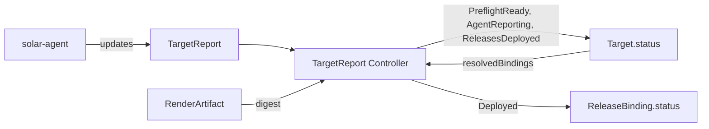

# TargetReport Controller

## Overview

The TargetReport controller turns the `TargetReport` a solar-agent writes into
conditions on that agent's `Target`, and the Target's `status.resolvedBindings`
into status on each `ReleaseBinding`. The report stays the agent's raw snapshot;
everything SolAr derives from it lives on the Target and its bindings, so the UI
and other controllers read conditions only.

Report and Target share name and namespace. The report is written only by the
agent, and pre-created empty by the [AgentCredential
controller](agentcredential_controller.md).

## Report states

Each reconcile reads the Target (uncached, see below) and the report, and
classifies the report first:

| State | When |
| ----- | ---- |
| Missing | The Target has no report. No agent is expected. |
| NoReport | The report exists, but `spec.lastReportTime` is empty: the agent never wrote it. |
| Stale | The controller hasn't seen `spec.lastReportTime` change for longer than `--agent-report-stale-after`. |
| Incomplete | The report is fresh, but `spec.releasesError` is set: the agent could not read its Flux objects. `spec.releases` then holds the last successful read. |
| Fresh | The report is fresh and complete. |

A stale report is stale whether or not it carries an error.

## Conditions on the Target

| Condition | Status | Reason | When |
| --------- | ------ | ------ | ---- |
| `PreflightReady` | | | Aggregate of `spec.preflight.checks`, see below |
| `AgentReporting` | `True` | `Reporting` | Fresh or Incomplete |
| `AgentReporting` | `Unknown` | `NoReport` | NoReport |
| `AgentReporting` | `False` | `Stale` | Stale |
| `ReleasesDeployed` | | | Roll-up of the bindings' `Deployed`, see [ReleasesDeployed](#releasesdeployed) |

A Target without a report gets none of these conditions. If the report is
deleted, they are removed. With agent credentials enabled the AgentCredential controller
re-creates a missing report, so a deleted report only stays gone while the
Target's credentials are revoked or disabled.

### Preflight

`PreflightReady` rolls up the agent's checks. Per-check results stay in the
report: a snapshot can't know their transitions.

| Status | Reason | When |
| ------ | ------ | ---- |
| `False` | `ChecksErroredAndFailed` | At least one check failed and one could not be evaluated |
| `False` | `ChecksFailed` | At least one check failed |
| `Unknown` | `ChecksErrored` | At least one check could not be evaluated |
| `Unknown` | `NoChecks` | The report has no checks, as the pre-created report |
| `True` | `AllChecksPassed` | Every check passed |

Check reasons are constants in `api/solar/v1alpha1` (`CheckReasonPresent`,
`CheckReasonMissing`, `CheckReasonUnavailable`), as are `PreflightReady` and its
reasons (`ConditionTypePreflightReady`, `ReasonChecksFailed` and so on).

### Liveness

The agent pushes its report when something changed, and at least every
`--max-report-age` (default 10 intervals of 30s, so 5m) as a heartbeat.
`--agent-report-stale-after` (chart value `controller.agent.reportStaleAfter`,
default 10m) is twice that, so one missed heartbeat doesn't flap the Target.
The heartbeat is 10 times the agent's `--interval` unless `--max-report-age` is
set, so agents with a longer interval or heartbeat need a higher threshold.

Nothing triggers a reconcile when an agent falls silent, so after each fresh
report the controller requeues for the moment that report would go stale.

The condition messages carry no timestamps. A heartbeat that changes nothing
but `lastReportTime` therefore leaves the Target untouched. The time of the last
report is read from the report itself, for example by the UI's Agent card.

Staleness depends on the controller's clock only. The agent stamps
`lastReportTime` itself, so the controller uses it only to tell that the agent
wrote again: it remembers, in memory, when it first saw each value, and a
report goes stale once that is older than the threshold. The SolAr apiserver
keeps no `managedFields`, so there is no server-side write time to use instead.

After a controller restart or leader change, every report counts as written at
the moment the controller first sees it, except on Targets that were already
`Stale`: those stay `Stale` until the agent writes again. A silent agent whose
Target still showed `Reporting` is therefore marked `Stale` up to one threshold
later than without the restart.

## Binding status

The controller writes each listed binding's `Deployed` condition, across
namespaces, whether or not the Target has a report. It joins the list entry
with the report entry whose `name` is the entry's `uniqueName`.
`Filtered` and `Unresolved` come from the list alone:

| `Deployed` | Reason | When |
| ---------- | ------ | ---- |
| `False` | `Filtered` | The release resolver dropped the binding. Doesn't depend on the agent. |
| `Unknown` | `Unresolved` | The binding names the Target, but its Release, ComponentVersion or ReferenceGrant is missing. |
| `Unknown` | `NoReport` | The report exists, but the agent never wrote it. |
| `Unknown` | `AgentNotReporting` | The report is stale. |
| `Unknown` | `ReportIncomplete` | The report has `releasesError` set, two entries share the `uniqueName`, or the entry has an unknown phase. |
| `False` | `Pending` | The report has no entry for the `uniqueName`, or only half a Flux pair. |
| `False` | `Progressing` | Flux is still working, or the release is `Ready` but its live chart isn't the newest rendered one. |
| `False` | `Degraded` | Not ready, Flux retries. |
| `False` | `Failed` | Not ready, Flux doesn't retry. |
| `True` | `Ready` | `Ready`, and the newest rendered chart is live. |

A binding without a report (state Missing) gets no `Deployed` condition. A
`Deployed` and flags it had before, for example while a `Filtered`, an
`Unresolved` or a since deleted report applied, are removed.

The message of `Failed`, `Degraded` and `Progressing` is the `Ready` message of
the first half of the pair that isn't ready, prefixed with `OCIRepository` or
`HelmRelease`.

**Is the newest chart live?** `newestChartLive` compares the entry's
`desiredRevision`, the rendered chart tag, with the version part of the
reported `revision`. Flux drops the tag's leading `v` and appends the first 12
hex characters of the chart digest after a `+` (`0.0.3-ab12+0cc9a8446c95` for
`v0.0.3-ab12`), so the `v` is ignored. That digest must be a prefix of the
`status.digest` of the entry's `RenderArtifact`, which the [RenderArtifact
controller](renderartifact_controller.md#chart-digest) records. Otherwise the
binding is `Progressing`:

| Check | Message when it fails |
| ----- | --------------------- |
| The live version is the desired one | Names both revisions |
| The rendered chart's digest is known | Says the digest isn't known yet: fail closed |
| The live digest matches it | Names both digests |

A missing `RenderArtifact`, or an entry without one, counts as an unknown
digest. If the reported `revision` has no digest, for example with
helm-controller's `DisableChartDigestTracking`, only the version is compared.
An older chart still running is `Progressing`, never a failure.

`status.deployment` holds the last phase and live revision the agent reported,
and the desired revision and digest. While the report is stale, incomplete or
not yet written, the stored phase and live revision stay, so the UI can show
"last seen Failed"; only the desired revision and digest follow the list.

Flag conditions can be true beside any `Deployed` state. They copy the Flux
reason and message:

| Condition | Source |
| --------- | ------ |
| `RolledBack` | `HelmRelease` `Remediated`: `True` with reason `RollbackSucceeded`, otherwise `False` |
| `Drifted` | `HelmRelease` `Drifted` |
| `TestFailed` | `HelmRelease` `TestSuccess`, inverted |
| `Verified` | `OCIRepository` `SourceVerified` |

A flag whose Flux condition is absent is absent too, and a flag goes when its
release has no report entry, and for `Filtered` and `Unresolved`. While the
report is stale, incomplete or not yet written, or two entries share the
`uniqueName`, the flags go `Unknown` with the same reason as `Deployed`.

A listed binding that no longer exists, or whose `targetRef` now names another
Target, is skipped: the list survives the Target controller's early returns, so
it can be out of date.

A binding that names the Target but isn't listed, for example because its
ReferenceGrant was revoked, must not keep an old `Deployed=True`. The controller
lists the bindings whose `targetRef` names the Target from its cache, through
the same field index the Target controller uses, and sets any such binding that
has a `Deployed` condition to `Unknown`/`Unresolved`.

Binding status is written through the `/status` subresource and only when it
changed. `TargetReconciler` ignores binding updates that change neither the spec
nor the deletion timestamp, so these writes don't re-render the Target.

## ReleasesDeployed

`ReleasesDeployed` on the Target rolls up the outcome of every entry in
`resolvedBindings`, also those whose binding no longer exists, since the list is
what the Target is expected to run. Filtered entries don't count. The outcomes
are derived before the Target is written, and the bindings after it.

| Status | Reason | When |
| ------ | ------ | ---- |
| `True` | `AllReady` | Every counted binding is `Ready`, or none is counted. Message `2 of 2 ready`, `0 of 0 ready`. |
| `False` | Worst `Deployed` reason: `Failed`, `Degraded`, `Unresolved`, `Progressing`, `Pending` | The message counts the ready bindings and names the others, grouped by reason in that order, e.g. `1 of 3 ready; Failed: monitoring; Progressing: ingress`. |
| `Unknown` | `NoReport`, `Stale`, `ReportIncomplete` | The report state, with the same reason as `AgentReporting`, or `ReportIncomplete` for `releasesError`. |
| `Unknown` | `ReportIncomplete` | The report is fresh, but every binding that isn't ready has `Deployed` `Unknown` with `ReportIncomplete`. |

Bindings are named by `uniqueName`, or by namespace and name while they have
none (`Unresolved`). On a fresh report, bindings with `ReportIncomplete` are
named last and don't outrank a definite reason. The UI's health badge reads
this condition, see the [operator
manual](../operator-manual/solar-agent.md#a-targets-overall-state).

## Concurrency

`Target.status` has other writers (the Target and AgentCredential controllers),
all using a full status update. The controller reads the Target through an
uncached reader, so a concurrent write surfaces as a conflict, which is
returned and retried with a fresh read, rather than being overwritten.

## Watch Triggers

- A `TargetReport` is created, updated or deleted.
- A `Target` is created, so a report that existed before its Target is synced.
- A `Target`'s `status.resolvedBindings` changes. Its other status writes, this
  controller's included, are ignored.
- A `RenderArtifact`'s `status.digest` changes. It maps to the Targets in its
  namespace whose `resolvedBindings` name it, read from the cache.
- A requeue when the last fresh report would go stale.
