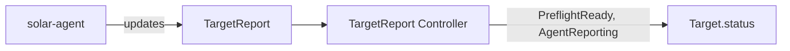

# TargetReport Controller

## Overview

The TargetReport controller turns the `TargetReport` a solar-agent writes into
conditions on that agent's `Target`. The report stays the agent's raw snapshot;
everything SolAr derives from it lives on the Target, so the UI and other
controllers read conditions only.

Report and Target share name and namespace. The report is written only by the
agent, and pre-created empty by the [AgentCredential
controller](agentcredential_controller.md).

## Report states

Each reconcile reads the Target (uncached, see below) and the report, and
classifies the report first:

| State | When |
| ----- | ---- |
| Missing | The Target has no report. No agent is expected. |
| NoReport | The report exists, but `spec.lastReportTime` is empty: the agent never wrote it. |
| Stale | `spec.lastReportTime` is older than `--agent-report-stale-after`. |
| Incomplete | The report is fresh, but `spec.releasesError` is set: the agent could not read its Flux objects. `spec.releases` then holds the last successful read. |
| Fresh | The report is fresh and complete. |

A stale report is stale whether or not it carries an error.

## Conditions on the Target

| Condition | Status | Reason | When |
| --------- | ------ | ------ | ---- |
| `PreflightReady` | | | Aggregate of `spec.preflight.checks`, see below |
| `AgentReporting` | `True` | `Reporting` | Fresh or Incomplete |
| `AgentReporting` | `Unknown` | `NoReport` | NoReport |
| `AgentReporting` | `False` | `Stale` | Stale |

A Target without a report gets neither condition. If the report is deleted, both
are removed. With agent credentials enabled the AgentCredential controller
re-creates a missing report, so a deleted report only stays gone while the
Target's credentials are revoked or disabled.

### Preflight

`PreflightReady` rolls up the agent's checks. Per-check results stay in the
report: a snapshot can't know their transitions.

| Status | Reason | When |
| ------ | ------ | ---- |
| `False` | `ChecksErroredAndFailed` | At least one check failed and one could not be evaluated |
| `False` | `ChecksFailed` | At least one check failed |
| `Unknown` | `ChecksErrored` | At least one check could not be evaluated |
| `Unknown` | `NoChecks` | The report has no checks, as the pre-created report |
| `True` | `AllChecksPassed` | Every check passed |

Check reasons are constants in `api/solar/v1alpha1` (`CheckReasonPresent`,
`CheckReasonMissing`, `CheckReasonUnavailable`).

### Liveness

The agent pushes its report when something changed, and at least every
`--max-report-age` (default 10 intervals of 30s, so 5m) as a heartbeat.
`--agent-report-stale-after` (chart value `controller.agent.reportStaleAfter`,
default 10m) is twice that, so one missed heartbeat doesn't flap the Target.
The heartbeat is 10 times the agent's `--interval` unless `--max-report-age` is
set, so agents with a longer interval or heartbeat need a higher threshold.

Nothing triggers a reconcile when an agent falls silent, so after each fresh
report the controller requeues for the moment that report would go stale.

The condition messages carry no timestamps. A heartbeat that changes nothing
but `lastReportTime` therefore leaves the Target untouched. The time of the last
report is read from the report itself, for example by the UI's Agent card.

Staleness compares the agent's clock with the controller's. The threshold
absorbs ordinary skew, but a badly wrong clock on a target cluster can hide or
fake staleness.

## Concurrency

`Target.status` has other writers (the Target and AgentCredential controllers),
all using a full status update. The controller reads the Target through an
uncached reader, so a concurrent write surfaces as a conflict, which is
returned and retried with a fresh read, rather than being overwritten.

## Watch Triggers

- A `TargetReport` is created, updated or deleted.
- A `Target` is created, so a report that existed before its Target is synced.
- A requeue when the last fresh report would go stale.
